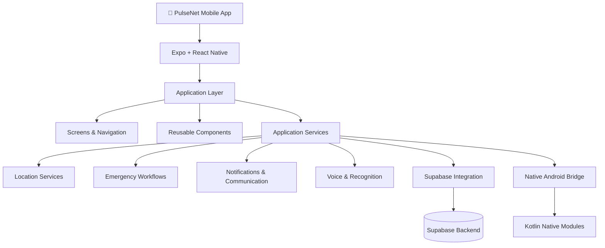

<div align="center">


# PulseNet

### Your Safety. Connected.

**A personal safety and emergency-response platform built to make getting help smarter, more connected and more accessible.**

<br/>

[](https://expo.dev/)
[](https://reactnative.dev/)
[](https://www.typescriptlang.org/)
[](https://supabase.com/)
[](https://developer.android.com/)

<br/>

[ABOUT](#-about-pulsenet) • [FEATURES](#-features) • [TECHNOLOGY](#-technology-stack) • [INSTALLATION](#-getting-started) • [ROADMAP](#-roadmap)

</div>

---

## 🌐 About PulseNet

**What if getting help during an emergency could be faster, smarter and more connected?**

PulseNet is a personal safety application designed around one fundamental idea:

**Help should never feel out of reach.**

Built using Expo, React Native and TypeScript, PulseNet brings together personal safety tools, emergency workflows, communication capabilities and intelligent technology within one mobile platform.

The vision is to create an ecosystem where individuals can access safety features, manage emergency contacts, initiate distress workflows and interact with tools designed to support them when it matters most.

This is more than an application.

It is an attempt to rethink how technology can contribute to personal safety.

> Technology should not only make life easier. It should help protect it.

---

## ⚡ The Vision

PulseNet is being developed around six fundamental principles.

| Principle | Purpose |
|---|---|
| 🛡️ Safety First | Prioritising user safety in every major design decision. |
| ⚡ Accessibility | Making essential safety tools simple to access. |
| 🧠 Intelligence | Using technology to support better-informed decisions. |
| 🔗 Connectivity | Connecting users, emergency contacts and relevant services. |
| 🔐 Privacy | Protecting sensitive information and personal data. |
| 🌍 Scalability | Building a foundation for future expansion. |

---

## 🚀 Features

PulseNet brings together multiple areas of personal safety technology.

### 🆘 Emergency & SOS

Emergency-response workflows designed to help users initiate assistance when they need it.

- SOS activation workflow.
- Emergency-contact management.
- Emergency communication workflows.
- SOS drill mode for safe testing.
- Extensible emergency-service architecture.

### 📍 Location & Awareness

Location-aware functionality designed to support safety workflows.

- Device location integration.
- Location-related emergency functionality.
- Connectivity-aware services.
- Foundation for future location-based safety capabilities.

### 🔔 Notifications & Communication

Communication capabilities designed to support important safety events.

- Notification infrastructure.
- SMS integration.
- Emergency workflow notifications.
- Communication-oriented service architecture.

### 🎙️ Voice & Distress Technology

An extensible foundation for voice-assisted safety functionality.

- Speech-recognition integration.
- Voice-oriented emergency workflows.
- Native Android functionality for platform-specific capabilities.

### 🧠 Intelligent Safety

The longer-term vision includes advanced safety intelligence.

Planned development areas include:

- Context-aware emergency classification.
- Natural-language processing.
- Emergency incident summaries.
- Intelligent notification prioritisation.
- Duplicate incident detection.
- Predictive safety analytics.

*Not every feature described in the vision is currently implemented or production-ready.*

---

## 🏗️ Technology Stack

PulseNet uses a modern mobile development ecosystem.

| Technology | Purpose |
|---|---|
| React Native | Cross-platform mobile development |
| Expo SDK 58 | Mobile development infrastructure |
| TypeScript | Type-safe application development |
| Expo Router | Application navigation |
| Supabase JS | Backend and database integration |
| Kotlin | Native Android functionality |
| Jest | Automated testing |
| EAS Build | Cloud-based Android builds |

<div align="center">


</div>

---

## 🧩 Architecture

PulseNet follows a modular architecture intended to separate application screens, business logic, reusable components and platform-specific functionality.



### Project Structure

```text
PulseNet-Expo/
│
├── assets/
├── docs/
├── modules/
│   └── pulsenet-native/
├── scripts/
│
├── src/
│   ├── app/
│   ├── components/
│   ├── services/
│   ├── data/
│   └── lib/
│
├── supabase/
├── tests/
│
├── app.json
├── eas.json
├── package.json
├── tsconfig.json
└── README.md
```

---

## 💻 Getting Started

Want to explore PulseNet or contribute to its development?

Follow these steps.

### Prerequisites

Make sure you have:

- Node.js installed.
- npm installed.
- Git installed.
- An Android phone with a compatible Expo Go version.
- An Expo account for cloud builds.

### 1. Clone the repository

```bash
git clone https://github.com/LungstarDaKing/PulseNet-Expo.git
```

### 2. Enter the project directory

```bash
cd PulseNet-Expo
```

### 3. Install dependencies

```bash
npm install
```

### 4. Start the development server

```bash
npx expo start
```

Scan the QR code using Expo Go if your installed Expo Go version supports the project's SDK.

**Important:** Functionality requiring custom native Android modules needs a compatible development or preview build rather than standard Expo Go.

---

## 📦 Building PulseNet

PulseNet uses Expo Application Services (EAS) for cloud-based Android builds.

### Install EAS CLI

```bash
npm install -g eas-cli
```

### Log in

```bash
eas login
```

### Configure the project

```bash
eas init
```

### Generate a preview APK

```bash
eas build -p android --profile preview
```

### Build profiles

| Profile | Purpose |
|---|---|
| Development | Development client for debugging native functionality |
| Preview | Installable Android APK for testing |
| Production | Android App Bundle for distribution |

Build configuration is maintained in `eas.json`.

---

## 🧪 Testing & Quality Assurance

Reliability is particularly important in applications involving personal safety.

PulseNet includes an automated testing setup and TypeScript validation.

Run the following commands:

```bash
# TypeScript validation
npm run typecheck

# Automated unit tests
npm test

# Expo configuration and dependency checks
npx expo-doctor

# Linting
npm run lint
```

The repository documents **67 unit tests**.

Testing remains an ongoing part of development. Passing unit tests does not certify emergency-service reliability.

### Safe SOS Testing

PulseNet includes an SOS drill mode.

Navigate to:

**Settings → SOS Drill Mode**

This allows the SOS workflow to be exercised without sending real emergency communications.

Never use public emergency numbers as test destinations.

---

## 🔐 Security & Privacy

Personal safety applications must take privacy seriously.

PulseNet's development is guided by the following principles:

- Protect sensitive user information.
- Avoid exposing credentials in source code.
- Use secure authentication and communication practices.
- Restrict access to sensitive backend resources.
- Apply appropriate permissions for location and device functionality.
- Minimise unnecessary collection of personal information.

**Security reminder:** Never commit Supabase service-role keys, private API keys, passwords or other secrets to a public repository.

PulseNet is a developing software project. It is not a certified emergency-response service or a replacement for official emergency services.

---

## 🗺️ Roadmap

The vision for PulseNet extends beyond its current implementation.

The following roadmap represents development goals, not claims of completed functionality.

- [x] Migration from Flutter to Expo and React Native.
- [x] TypeScript-based application architecture.
- [x] Expo Router integration.
- [x] Native Android module foundation.
- [x] Automated testing infrastructure.
- [x] EAS cloud-build configuration.
- [x] SOS drill-mode workflow.
- [ ] Expand and validate emergency communication capabilities.
- [ ] Strengthen backend integration and security.
- [ ] Expand intelligent emergency classification.
- [ ] Develop incident detection and summarisation.
- [ ] Improve emergency contact coordination.
- [ ] Introduce advanced safety analytics.
- [ ] Expand platform support and native capabilities.
- [ ] Prepare for wider testing and eventual public release.

**The goal: Build a dependable, accessible and intelligent personal safety ecosystem.**

---

## 🤝 Contributing

PulseNet is an evolving project, and constructive contributions are welcome.

If you are interested in improving the project:

1. Fork the repository.
2. Create a feature branch.
3. Make your changes.
4. Run the available checks.
5. Submit a pull request explaining your improvements.

```bash
git checkout -b feature/your-feature
git add .
git commit -m "feat: describe your improvement"
git push origin feature/your-feature
```

Please prioritise security, reliability, accessibility and responsible handling of emergency functionality.

---

## 👨‍💻 Creator

<div align="center">


### Lungelo "LungstarDaKing" Mtetwa

**Founder & Developer | PulseNet**

A young technology enthusiast passionate about software engineering, artificial intelligence, innovation and building technology that solves real-world problems.

PulseNet represents a commitment to exploring how software can contribute to a safer and more connected world.

<br/>

[](https://github.com/LungstarDaKing)

[](https://github.com/LungstarDaKing/PulseNet-Expo)

</div>

---

## 📜 License

No open-source licence is currently specified in this repository.

Until a licence is added, all rights are reserved by the copyright holder. Do not assume the source code is available for unrestricted reuse or redistribution.

---

<div align="center">


# PULSENET

### Because Every Second Matters.

**Built with vision. Engineered with purpose. Designed around safety.**

<br/>


**© Lungelo Mtetwa · PulseNet**

</div>
